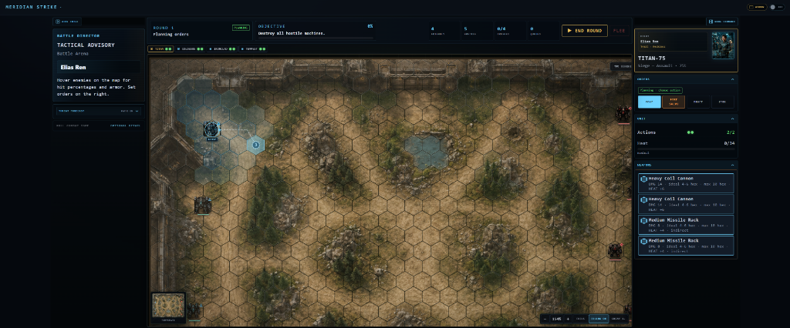

# Controls & Interface Reference

Mastering **Meridian Strike** requires fluent use of planning tools, tactical camera navigation, and action execution controls.

---

## Keyboard Hotkeys & Mouse Controls

These are the defaults. In **Settings ? Controls**, select a letter binding and press a letter or number. Conflicts offer **Swap bindings** or **Cancel**; **Reset to defaults** restores the table below. Bindings persist across restarts and update battle hints. Escape, Enter, and Space retain their fixed navigation/confirmation roles. Modified shortcuts (Ctrl, Alt, Meta) are ignored by battle commands.

**Known accessibility limitation:** `Tab` / `Shift+Tab` always cycle living machines during planning (`preventDefault`), including when a HUD button, zoom control, or End round control is focused. Native tab order does not move through those controls. Objective and other modal dialogs still trap Tab. Letter commands stay blocked while typing in inputs.

| Action                | Keyboard Shortcut   | Mouse Input                      |
| :-------------------- | :------------------ | :------------------------------- |
| **Cycle Units**       | `Tab` / `Shift+Tab` | Click unit on map or HUD card    |
| **Move Command**      | `M`                 | Left Click destination hex       |
| **Sprint**            |                     | Click "Sprint", then destination |
| **Fire Command**      | `F`                 | Click "Fire salvo" then a target |
| **Brace**             | `B`                 | Click "Brace" button             |
| **Cool**              | `C`                 | Click "Cool" button              |
| **Confirm Ram**       | `Space`             | Click "Confirm Ram" button       |
| **End round**         | `Enter` or `E`      | Click "▶ End round"              |
| **Toggle Map Focus**  | `V`                 | Click the map-focus control      |
| **Camera Pan**        |                     | Middle Click + Drag              |
| **Camera Zoom**       |                     | Mouse Scroll Wheel               |
| **Open Menu / Pause** | `Esc`               | Click Menu button                |

---

## Gamepad Support

Meridian Strike supports standard gamepads for basic menu and UI navigation:

- **D-Pad**: Navigate focus between menu buttons and list items.
- **A / Cross**: Activate selected control or button.
- **B / Circle**: Cancel / Go back / Close menu.

_(Note: Full tactical combat mapping, such as moving the cursor across the hex grid or panning the camera, is not currently supported on gamepads. Use a mouse and keyboard for combat execution.)_

---

## Interface Layout & Drawers

The capture is representative of the current layout (map, right command deck with **▶ End round** / **Flee**, left Director/intel). On constrained widths the idle Intel rail starts collapsed; hover an enemy in Move or Fire for the unified **Enemy intel** card.

1. **Command Sidebar (Right Rail)**: The primary command center. Contains pilot and mech stats, the orders panel, heat/armor tracking, and the weapons loadout where you toggle active hardpoints and view target intel.
2. **Intel Rail (Left Rail)**: Displays narrative events, pilot transmissions, and the combat action log.
3. **Context Strip (Bottom Overlay)**: Provides a quick summary of the active machine's available Action Points (AP), current heat, and queued orders.
4. **Tactical Minimap (Left Chrome)**: Shows global battlefield geometry and allows for quick camera jumping.

**Flee** has no hotkey; use the command-deck button once a machine has **resolved** onto an escape hex. Emergency Overload and weapon checkboxes are mouse/UI only.

### Facing and turning

After plotting a move, use **End facing** in Orders to choose one of six directions.
The default follows the last path edge. The destination ghost shows the chosen
facing; the arrow and shaded rear arc use the same directions as combat.

With no move queued, **Stationary turn** changes facing once per activation for
free, leaving both AP for other orders. Shutdown blocks turning. Use Tab and
Enter on the six direction buttons, or click them. A rear attack gains +15 hit
and favors torso hits. Front and rear armor protect one shared core structure
pool: rear torso hits consume rear armor, then core structure, without touching
front armor. A core breach destroys the machine. Protect exposed rear armor, but
watch for opponents approaching from two directions.

### Sprint

**Sprint** spends both actions on one extended move. It uses 250% of the
machine's current movement budget, rounded up after heat and leg-damage penalties:
two normal moves plus half of one move. Fast
light machines gain the most extra hexes. Choose **Sprint**, click a highlighted
destination, then set **End facing** as with a normal move.

A successful Sprint grants an extra **-5% incoming hit chance** on top of normal
moving-target defense until that machine's next activation. It cannot be combined
with fire, Brace, Cool or another move because it spends both actions. Sprint
still crosses threatened hexes normally: overwatch checks each ground-movement
hex and a jump Sprint checks its landing hex. Broken terrain, occupied
destinations, heat shutdown and destroyed legs constrain it through the same
movement rules as Move.

With both legs destroyed, **Crawl** replaces Move: one adjacent walkable hex
per activation, costing one AP even in slow terrain. Sprint, jump and ram are
unavailable. Crawling provides no movement evasion and does not clear stationary
exposure. Cover, Brace, Cool, firing and trained pilot skills remain available.

### Called shots

Pilots with **Gunnery 7** can select an **Aim location** in Fire mode. Normal
fire keeps random hit locations. Focused aim multiplies the selected location
weight by **4**, then rolls normally on a successful hit. It applies **-25 accuracy**,
or **-40** when aiming at Command. It improves location odds without guaranteeing
a hit there. The picker shows the location probability conditional on hitting;
weapon previews show hit chance separately. AP, heat and overload costs are unchanged.

Already-destroyed locations cannot be selected. Front Core aim requires a frontal
shot; Rear aim requires a rear shot. A committed salvo keeps its aim bias after a
part breaks, and any further hits there use the normal overflow-to-core rule.
The queued order and combat log identify called shots. Qualified enemy pilots
can also aim at exposed parts; protect weak armor or break their firing line.

### Overwatch

**Reflex 7** unlocks **Reserve overwatch (1 AP)** in Orders. Select weapons in
Loadout first. The whole selection must fit the current heat capacity. Use Tab
and Enter to activate the button; **Show overwatch arc** previews its coverage.

Overwatch fires once when an opponent moves through the front three directions,
within weapon range and direct line of sight. Cyan hexes show your preview;
red dashed hexes and an OVERWATCH label identify enemy reservations. Missiles
also need direct sight for reactions. Jump routes trigger only at landing.

Heat is paid when the reaction fires. Reserving after firing keeps repeat-fire
accuracy and heat penalties. Moving, firing or ramming cancels the reservation;
Brace and Cool retain it. Unused reservations expire at the next activation.
There is no reaction overload or called shot. Damage that destroys a mover stops
it at the interception hex; losing the second leg also stops the current route.
Approach from behind, break sight with terrain or bait the single reaction.

### Pilot skills

Each attribute unlocks a once-per-mission active skill at **7**. The pilot's
attribute rows name unlocked skills, and the Orders panel shows available,
queued and used states. Gunnery unlocks **Called Shot** and Reflex unlocks
**Overwatch**, described above. The other four skills are:

- **Emergency Vent (Technical):** spend 1 AP to remove 8 heat. It remains
  available during shutdown and can restore normal follow-up orders if the vent
  takes heat below capacity.
- **Shared Focus (Command):** spend 1 AP and mark one hostile. Every ally gains
  **+10 hit chance** against that target for the rest of the round. Planned
  allied attacks resolve after the commander establishes focus.
- **Evasive Stance (Instinct):** spend 1 AP for **-15 incoming hit chance**
  until the pilot's next activation. It stacks with movement defense and any
  defense that applies while stationary.
- **Push Through (Resolve):** once during heat shutdown, spend no AP to lower
  heat to one below capacity. The machine keeps its one shutdown-recovery AP
  for any legal order.

Each skill can be used once per mission by that pilot-machine unit. Usage,
queued orders, Evasive Stance and Shared Focus persist through battle reloads.
Shared Focus expires when the next round starts; Evasive Stance expires when
its owner next activates.
